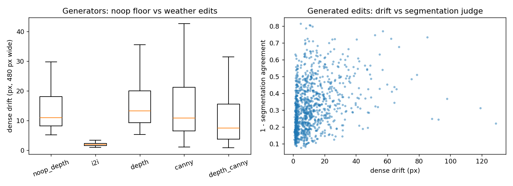
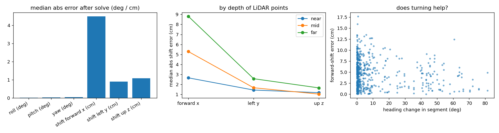
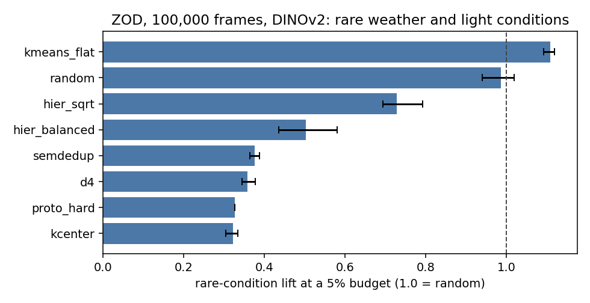
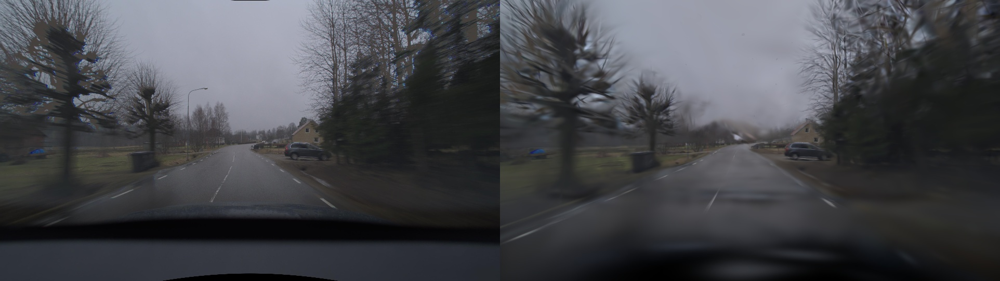

# driving-geometry

Six small studies on real driving data: dashcam images from [BDD100K](https://www.vis.xyz/bdd100k/) (the 10,000-image validation split, 9,992 downloaded), camera + LiDAR drives from [Argoverse 2](https://www.argoverse.org/av2.html), and the Zenseact Open Dataset ([ZOD](https://zod.zenseact.com/): 100,000 frames and one 20-second drive with LiDAR). They share one library (`dgeo/`) with embeddings, retrieval, camera geometry and bootstrap statistics. The GPU work ran on Modal and Kaggle.

## What I did

**1. Curation: picking which images to keep.**
- Using only DINOv2-small or CLIP ViT-B/32 embeddings (never the labels), I picked 1% or 5% of the 9,992 images with eight methods: random, flat k-means, SemDeDup, D4, SSL Prototypes (keep the hardest examples), two hierarchical k-means variants and greedy k-center.
- I scored how many rare scene types (at most 5% of the data: parking lot, tunnel, gas station) each pick covers. "Undefined" labels are not counted as scenes.
- Then I added a downstream test: split the images 70/30, let each method pick 5% of the 70%, train a logistic-regression classifier on the picked images (using the other embedding model's features), and score it on the held-out 30% for scene, weather, time of day and weather-plus-time combinations. Three splits, three seeds.

**2. Drift: a "did the scene move?" metric.**
- It compares an original and an edited photo with dense optical flow, SIFT matches with RANSAC, an essential-matrix rotation and edge precision.
- I tested it on 30 real photos with edits of known effect (shifts, rotations, elastic warps, fog, night, rain, blur, pasted-in objects) and compared it with two independent judges that do not use optical flow: semantic-segmentation agreement (SegFormer) and monocular-depth rank correlation (Depth Anything V2).

**3. Generated weather edits on Modal.**
- On a Modal A10G GPU I generated fog, night, rain and snow edits of the same 30 photos with five generator settings: img2img with no structural control, depth ControlNet, canny ControlNet, depth + canny ControlNet, and a depth ControlNet given a neutral prompt (to measure how much the generator moves things when asked for no change). Two seeds each, 1,920 scored images in total, all scored at the same 480 px width.

**4. Camera calibration from real drives on Modal.**
- On 57 Argoverse 2 drives (286 segments of about 3 s, half from the most-turning drives) I took the front-centre camera as trusted and moved a front stereo camera away from its reference position. I recovered it by projecting LiDAR points into both images and minimising the photometric difference between the two views.
- I also ran: starting at the reference (no perturbation), starts from 0.25 to 2 degrees and 2.5 to 20 cm away, LiDAR points restricted to near, mid or far, segments grouped by how much the car turned, and a classical baseline (SIFT matches + PnP with LiDAR depth).

**5. Curation on ZOD: does the BDD100K result carry over to 100,000 frames?**
- I embedded all 100,000 ZOD frames with DINOv2-small and CLIP ViT-B/32 (Modal A10G) and ran the same eight samplers as in study 1 (random, flat k-means, SemDeDup, D4, SSL Prototypes, two hierarchical k-means variants, greedy k-center) at 1% and 5% budgets, 3 seeds each, on a 128-dimension PCA of each embedding.
- Rare values come from ZOD's own metadata: 6 conditions (normal/day 60.8%, normal/night 17.0%, wet/day 12.0%, snow/day 4.6%, wet/night 3.0%, snow/night 2.6%), 5 road types and 14 countries. The rare conditions are snow/day, wet/night and snow/night.
- The downstream test is the same as before: a logistic-regression probe is trained on the selected 5% of a training pool and scored on held-out frames, over 3 splits grouped by country and day so one drive never sits on both sides.

**6. 3D Gaussian Splatting on a real ZOD drive, and how much a wrong camera calibration costs.**
- I turned ZOD sequence 000000 (20 s, 356 m, 201 front-camera frames, 181 LiDAR sweeps, about 65 km/h) into a scene: the distorted front camera undistorted to 962x542, oxts ego poses composed with the factory camera extrinsics, and a colour-attributed LiDAR point cloud accumulated over the drive (600,000 points). Projecting that point cloud into a frame lines up with the road, trees and horizon ([overlay](results/zod_gs/lidar_overlay.png)).
- I trained 3D Gaussian Splatting (gsplat, 12,000 steps, about 950,000 Gaussians initialised from the LiDAR points, plus distant sky Gaussians) on 176 frames and scored 25 held-out frames (every 8th), with the bonnet masked. Run on a Kaggle GPU.
- Then I deliberately offset the camera-to-vehicle extrinsic by 0.5 degrees and 5 cm, 1 degree and 10 cm, and 2 degrees and 20 cm, and trained either with the wrong calibration left alone or with a 6-DoF correction (shared by all frames) optimised jointly with the Gaussians.

## Results

**Curation, rare-scene lift at a 5% budget (DINOv2; 1.0 is random)**

| method | rare-scene lift (95% CI) | rare scene types covered |
|---|---|---|
| random | 1.05 (0.49 to 2.12) | 56% |
| flat k-means | 1.32 (0.79 to 1.88) | 78% |
| SemDeDup | 5.03 (4.46 to 5.93) | 100% |
| D4 | 4.37 (4.14 to 4.71) | 100% |
| SSL Prototypes (hardest) | 6.77 (5.96 to 7.45) | 100% |
| hierarchical k-means, sqrt-balanced | 2.85 (1.99 to 3.92) | 89% |
| hierarchical k-means, balanced | 5.84 (5.52 to 6.18) | 100% |
| greedy k-center | 5.84 (5.14 to 6.45) | 100% |

- With CLIP, the same methods give lifts of 3.1 to 5.3 and random 1.05. The two models agree on what is rare (linear CKA 0.72, Spearman 0.73).
- Downstream, on the weather-plus-time-of-day combinations (rare combinations have 635 test images on average), recall on the rare combinations is 2.8% for a classifier trained on a random 5%, 9.6% for hierarchical balanced k-means, 5.4% to 6.0% for SemDeDup, D4, SSL Prototypes and k-center, and 33% when training on all the data. Macro-F1 goes from 0.115 (random) to 0.132 (hierarchical balanced k-means); all data gives 0.293.
- For weather alone macro-F1 goes from 0.231 (random) to 0.29 (SemDeDup), and for time of day from 0.636 to 0.671. Scene macro-F1 is about 0.27 to 0.29 for every method. Recall on the rare scene types is 0 for every sampler and 2.7% for all data; the held-out set has only about 23 images of them.



**Drift metric**
- Telling moved geometry from appearance-only edits (shifts of 2 px or more, rotations of 0.5 degrees or more and elastic warps of 2 px or more against fog, night, rain and blur): AUC 0.991 for dense flow drift, 1.000 for the sparse SIFT version, 0.859 for the essential-matrix rotation, 0.752 for edge precision, 0.588 for depth correlation and 0.179 for segmentation agreement.
- Generator settings (median dense drift in px / sparse drift in px): depth ControlNet with a neutral prompt 10.9 / 141; img2img at strength 0.5 1.8 / 10; depth ControlNet 13.2 / 152; canny ControlNet 10.8 / 44; depth + canny 7.4 / 1.4.
- With the depth ControlNet, the weather prompt adds on top of the neutral-prompt level: fog +1.1 px (95% CI -0.4 to 2.6), night +6.7 (4.1 to 9.4), rain +2.1 (-1.4 to 7.3), snow +7.2 (2.9 to 12.7).
- Across all generated edits, dense drift correlates with segmentation change at rho 0.40, with essential-matrix rotation at 0.43, with sparse drift at 0.49, with edge precision at 0.22, and with depth correlation at -0.09.



**Calibration (Argoverse 2, 57 drives)**
- Starting 0.5 degrees and 5 cm away, the rotations come back to 0.03 (roll), 0.06 (pitch) and 0.05 (yaw) degrees from the reference, and 83% of starts end with all three rotations within 0.1 degrees. Left and up shifts end at 1.1 and 1.2 cm, forward shift at 4.7 cm (initial errors 3.1, 1.9 and 3.3 cm).
- Starting exactly at the reference, the solver moves forward by a median 4.4 cm (left 0.9 cm, up 1.1 cm, rotations 0.02 to 0.04 degrees). The classical PnP baseline finds the same forward offset (3.5 cm) and is better on forward shift (4.1 against 4.5 cm); the photometric solver is better on roll (0.018 against 0.049 degrees), left shift (0.9 against 1.6 cm) and up shift (1.1 against 1.2 cm). The forward offset is 4.2 cm at standstill and 5.6 cm above 10 m/s.
- The reference extrinsics differ between logs by about 0.2 degrees and 0.4 cm (standard deviation, 80 distinct values for stereo_front_left across 141 logs).
- Basin of convergence: 90% of starts converge within 0.25 degrees and 2.5 cm, 83% at 0.5 degrees and 5 cm, 31% at 1 degree and 10 cm and 9% at 2 degrees and 20 cm.
- Depth of the LiDAR points: forward-shift error is 2.7 cm with points at 4 to 15 m, 5.3 cm at 15 to 30 m and 8.8 cm at 30 to 50 m. Rotation errors are 0.02 to 0.08 degrees at every depth.
- Turning: forward-shift error is 4.7 cm for segments with under 3 degrees of heading change, 4.6 cm at 3 to 10, 5.1 cm at 10 to 25 and 3.2 cm above 25 degrees (Spearman -0.13).
- The Cramer-Rao standard deviations (0.003 to 0.004 degrees, 0.09 to 0.19 cm) are much smaller than the spread of the actual errors across segments (0.13 to 0.47 degrees, 2 to 4 cm).



**ZOD curation (100,000 frames, DINOv2, 5% budget): none of the diversity samplers finds the rare conditions**

| sampler | rare-condition lift (95% CI; 1.0 is random) | probe macro-F1 on condition | probe recall on rare conditions |
|---|---|---|---|
| all data (reference) | n/a | 0.807 [0.788, 0.825] | 0.688 [0.659, 0.715] |
| flat k-means | 1.11 (1.09 to 1.12) | 0.736 [0.715, 0.756] | 0.513 [0.483, 0.540] |
| random | 0.99 (0.94 to 1.02) | 0.734 [0.712, 0.755] | 0.506 [0.473, 0.538] |
| hierarchical k-means, sqrt-balanced | 0.73 (0.69 to 0.79) | 0.728 [0.708, 0.746] | 0.484 [0.448, 0.515] |
| hierarchical k-means, balanced | 0.50 (0.44 to 0.58) | 0.676 [0.645, 0.706] | 0.384 [0.318, 0.443] |
| SemDeDup | 0.38 (0.36 to 0.39) | 0.603 [0.580, 0.633] | 0.239 [0.169, 0.313] |
| D4 | 0.36 (0.34 to 0.38) | 0.592 [0.570, 0.616] | 0.212 [0.144, 0.282] |
| SSL Prototypes | 0.33 (0.33 to 0.33) | 0.523 [0.514, 0.531] | 0.109 [0.003, 0.222] |
| greedy k-center | 0.32 (0.30 to 0.33) | 0.555 [0.547, 0.564] | 0.140 [0.074, 0.215] |

- This is the opposite of BDD100K, where greedy k-center picked rare scenes 4.83 times more often than random. On ZOD the methods that favour unusual images (k-center, D4, SemDeDup, SSL Prototypes) pick fewer snow and night frames than random does, and a probe trained on their picks is clearly worse than one trained on random frames. At a 1% budget the pattern is the same (random 1.02, flat k-means 0.86, k-center 0.40). CLIP gives the same ranking (flat k-means 1.09, random 0.99, k-center 0.29 at 5%).
- A likely reason, which I have not tested: snow and night are properties of the whole image, not of unusual-looking images. Outlier-seeking samplers pick glare, tunnels, tight junctions and other odd frames, and ZOD's rare conditions are common enough (2.6% to 4.6% each) that a random 5% already contains many of them.
- Every sampler covers all six conditions at both budgets (rare coverage 1.00), so the difference is in how often rare frames are picked, not whether they appear.
- Road type has no value under 5% of the frames, so it has no rare-class numbers. For countries (14, most of them rare) flat k-means has lift 1.19 and random 1.08 at 5%, hierarchical sqrt-balanced 0.98 and the outlier samplers 0.37 to 0.44; the probe numbers are in the downstream report.
- DINOv2 and CLIP agree only moderately on which frames are rare on ZOD (linear CKA 0.70, Spearman 0.58, top-5% overlap 0.22).
- Choices that differ from study 1: samplers run on a 128-dimension PCA of each embedding, and the hierarchical samplers use a leaf level of 4 times the budget (study 1 used 8). With the study 1 settings one 5% hierarchical k-means run on 100,000 frames took 11 minutes, which made the full benchmark infeasible.

**ZOD Gaussian Splatting (one 20-second drive, 25 held-out frames)**

| camera extrinsic offset | calibration left wrong: PSNR / SSIM / LPIPS | correction learned: PSNR / SSIM / LPIPS | rotation error left (deg) | translation error left (cm) |
|---|---|---|---|---|
| none (factory calibration) | 23.81 / 0.882 / 0.263 | n/a | 0 | 0 |
| 0.5 deg, 5 cm | 23.46 / 0.876 / 0.283 | 23.87 / 0.881 / 0.265 | 0.45 | 12.4 |
| 1 deg, 10 cm | 22.77 / 0.868 / 0.296 | 22.74 / 0.874 / 0.282 | 0.73 | 15.3 |
| 2 deg, 20 cm | 21.34 / 0.844 / 0.348 | 22.59 / 0.865 / 0.307 | 1.56 | 22.2 |



- A wrong camera calibration costs rendering quality: PSNR falls from 23.81 to 21.34 dB (-2.47) and LPIPS rises from 0.263 to 0.348 as the offset grows to 2 degrees and 20 cm.
- Learning a correction jointly with the Gaussians recovers part of that quality at 2 degrees and 20 cm (22.59 dB) and lowers the rotation error (2.00 to 1.56 degrees), but it does not recover the true calibration: the remaining translation error is larger than the offset I started with (12.4 cm from 5, 15.3 from 10, 22.2 from 20). The Gaussians can absorb a camera offset, so a better render is not evidence of a correct calibration. For comparison, study 4 (photometric LiDAR calibration on stereo pairs) recovered rotations to 0.03 to 0.06 degrees.
- Caveats: one drive, one run per row, one random direction for each offset, and only the front camera (ZOD sequences have one), so this is a calibration sensitivity test and not a multi-camera calibration method. The renders are soft at the image edges, and the held-out frames lie between training frames 1.8 m apart on a 65 km/h road, so the test is mostly view interpolation along the trajectory.

Full tables: [ZOD curation coverage](results/zod_curation/coverage_report.md), [ZOD curation downstream](results/zod_curation/downstream_report.md), [ZOD Gaussian Splatting](results/zod_gs/report.md), [curation coverage](results/curation_v2/coverage_report.md), [curation downstream](results/curation_v2/downstream_report.md), [drift v2](results/drift_v2/report.md), [calibration v2](results/calibration_v2/report.md). The first versions of the studies are in `results/curation_bdd`, `results/drift`, `results/drift_generated` and `results/calibration_av2`.

## How it was built

```
dgeo/embed.py, retrieval.py, match.py, geometry.py, stats.py        shared pieces
dgeo/curation/    prepare_bdd, embed_cli, samplers, baselines, downstream, run_v2     study 1
dgeo/drift/       metrics, synth_edits, validate_metric, modal_validate, analyse_v2   studies 2 and 3
dgeo/calibration/ av2 (loader), study (solver), baseline (PnP), modal_run_v2, analyse_v2   study 4
dgeo/zod/         run_curation (study 5: embeddings -> samplers -> coverage and downstream tests)
scripts/          launch_calibration (starts the Modal runs and returns), modal_zod_curation (ZOD embeddings, Modal GPU),
                  modal_zod_gs_prep (ZOD drive -> Gaussian Splatting scene), modal_zod_explore
kaggle/gs/        zod_gs.py, the Gaussian Splatting and calibration-offset runs (Kaggle GPU)
```

```bash
pip install -r requirements.txt && pip install -e . --no-deps
python -m dgeo.curation.prepare_bdd --out data/bdd
python -m dgeo.curation.run_v2 --emb dinov2=data/bdd/emb_dinov2-small.npz clip=data/bdd/emb_clip-vit-base-patch32.npz --manifest data/bdd/manifest.csv --seeds 3 --splits 3
modal run dgeo/drift/modal_validate.py --images data/bdd/drift_images --out results/drift_v2
python -m dgeo.drift.analyse_v2
modal run dgeo/calibration/modal_run_v2.py::survey
modal deploy dgeo/calibration/modal_run_v2.py && python scripts/launch_calibration.py --n-logs 60
python -m dgeo.calibration.analyse_v2
# ZOD (study 5): embeddings on a Modal GPU, then the benchmark on any machine
modal run scripts/modal_zod_curation.py::embed
python -m dgeo.zod.run_curation --emb dinov2=emb_dinov2-small.npz clip=emb_clip-vit-base-patch32.npz --index index.parquet --out results/zod_curation
# ZOD (study 6): build the scene on Modal, then train on a GPU (a Kaggle notebook with internet on runs kaggle/gs/zod_gs.py)
modal run scripts/modal_zod_gs_prep.py::prep --seq 000000
pytest
```

## Tech stack
Python, PyTorch, Transformers (DINOv2, CLIP, SegFormer, Depth Anything V2), Diffusers (Stable Diffusion 1.5 + ControlNet depth and canny), Modal (A10G and T4 GPUs), Kaggle GPU notebooks, gsplat (3D Gaussian Splatting), pyarrow, NumPy, SciPy, OpenCV (optical flow, SIFT, RANSAC, PnP), scikit-learn, pandas, matplotlib, pytest.

## Data
Yu et al., *BDD100K*, CVPR 2020 (BSD-3), via the FiftyOne copy at `dgural/bdd100k`. Wilson et al., *Argoverse 2*, NeurIPS Datasets and Benchmarks 2021 (CC BY-NC-SA 4.0), streamed from the open S3 bucket. Zenseact Open Dataset (ZOD), obtained from Zenseact under its own licence (see zod.zenseact.com): the Frames subset (100,000 camera frames with metadata) and `sequences_mini` (the one 20-second drive used here). The data is not redistributed.
