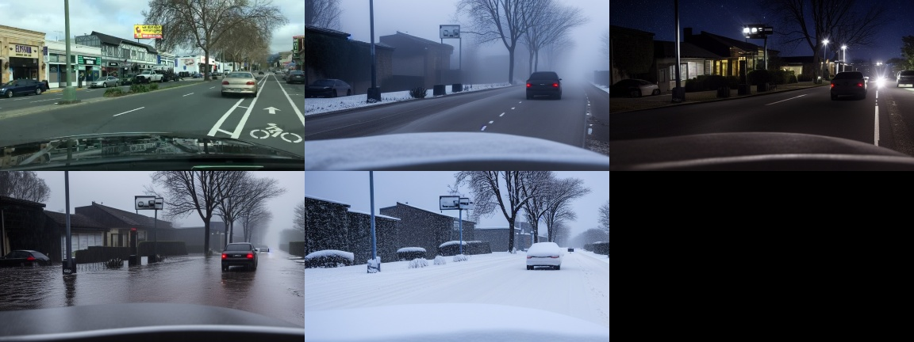

# ControlNet weather edits on 30 real BDD100K images, scored with the drift metric

Edits made on a Modal A10G (Stable Diffusion 1.5 + ControlNet depth, depth from Depth Anything V2 small, 25 steps, seed 0).

| edit | median dense drift (px) | min | max | median sparse drift (px) | mean edge precision | share of images with dense drift >= 2 px |
|---|---|---|---|---|---|---|
| fog | 13.38 | 5.52 | 30.91 | 148.5 | 0.70 | 100% |
| night | 16.11 | 5.84 | 77.48 | 138.3 | 0.74 | 100% |
| rain | 11.63 | 6.46 | 48.46 | 137.2 | 0.63 | 100% |
| snow | 15.49 | 5.69 | 78.09 | 156.3 | 0.67 | 100% |

For comparison, on the injected-edit validation the benign edits have median dense drift 0.09 px and geometric corruptions of 2 px or more have 2.63 px. A resize round trip of an image scores 0.03 px.

Top row: original, fog, night. Bottom row: rain, snow.
